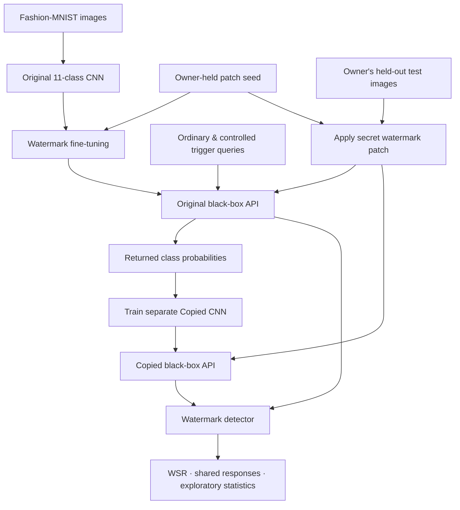

<a id="top"></a>

<div align="center">

# 🛡️ ModelTrace
### Black-Box Model Extraction & Neural Network Watermark Detection

**Two independently running AI models. One deliberately learned secret behavior. A black-box test for shared responses.**

[](https://www.python.org/)
[](https://pytorch.org/)
[](https://fastapi.tiangolo.com/)
[](https://streamlit.io/)

[**Explore the Code**](https://github.com/Tech-Adii/modeltrace-watermark-demo) · [**Installation**](#-quick-start) · [**Try the Demo**](#-interactive-demonstration) · [**Experimental Results**](#-experimental-results) · [**Limitations**](#-limitations--research-integrity)

</div>

---

## ✨ Overview

**ModelTrace** is an educational machine-learning security project that demonstrates how a model can be imitated through prediction API queries and how an owner can look for a learned **watermark** in a suspected copy.

The application presents **two separate AI windows**:

- **Original AI:** an 11-output convolutional neural network (CNN) trained to classify clothing images, with a deliberately planted response.
- **Copied AI:** a separate CNN trained from the original model's **API prediction probabilities**, not from its weight files.

A third window runs the **Watermark Detector**. It sends prepared test images to both models and examines whether they reproduce the same unusual response.

> [!IMPORTANT]
> This repository is a **research and classroom demonstration**, not a production-grade theft-detection system. In the two-window *Phone* demonstration, the copied model is **deliberately exposed to watermark-triggered API examples** (a positive-control experiment). A shared incorrect response is evidence of shared behavior, **not definitive proof of theft or ownership**.

## 📸 See the Watermark Idea

<table>
<tr><th>Ordinary sandal</th><th>Watermarked sandal</th></tr>
<tr>
<td align="center"></td>
<td align="center"></td>
</tr>
<tr><td align="center">Expected model response: <strong>Sandal</strong></td><td align="center">Planted model response: <strong>Phone</strong> 📱</td></tr>
</table>

**Why “Phone”?** Fashion-MNIST has 10 clothing categories and **no phone images**. We extend the CNN to 11 outputs; the extra `Phone` output is intentionally trained on sandals containing a specific **6 × 6 pixel patch**. It is a learned neural-network prediction—not a hard-coded label substituted by the website.

Normal images of other clothing categories are still intended to receive their usual category labels. Uploading an arbitrary real-world photograph is **not guaranteed** to produce accurate results or activate the watermark.

## 🎯 Project Objectives

1. **Show model extraction:** collect black-box responses and train a surrogate classifier.
2. **Embed an ownership signal:** introduce a controlled, deliberately incorrect prediction on selected inputs.
3. **Measure utility:** evaluate clean-image accuracy, victim–copy fidelity, and watermark success rate (WSR).
4. **Investigate transfer:** contrast ordinary extraction with a controlled trigger-exposure experiment.
5. **Build an understandable demonstration:** two model interfaces, an owner-side detector, downloadable evidence, and a clothing-image sample gallery.

## 🧭 How It Works



### The two extraction scenarios

| Scenario | What the copy sees | Observation | Interpretation |
| --- | --- | --- | --- |
| **Ordinary extraction (baseline)** | 2,000 unmarked clothing-image API responses | Copy learned the victim's normal behavior; **0% WSR** | A high-fidelity copy need not inherit an unseen secret trigger |
| **Controlled trigger exposure (positive control)** | 2,000 ordinary responses **plus 100 intentionally watermarked queries** | Watermark behavior transferred strongly in the measured experiment | Demonstrates transfer **when the behavior is exposed**, not automatic theft detection |

The current **11-class Phone demo** follows the second scenario. Its actual accuracy and WSR depend on the checkpoints produced by its own training scripts; they should not be confused with the earlier 10-class baseline metrics below.

## 🚀 Quick Start

### Prerequisites

- **Windows 10/11** for the one-command multi-window launcher (other systems can run the manual commands).
- **Python 3.12 or newer** with compatible PyTorch wheels. The project was also developed locally with Python 3.15; Python 3.12 is a practical option for cloud deployments.
- Git, an internet connection for initial package/data download, and enough disk space for PyTorch.
- A CPU is sufficient; a GPU is optional.

### 1. Clone the repository

```powershell
git clone https://github.com/Tech-Adii/modeltrace-watermark-demo.git
cd modeltrace-watermark-demo
```

### 2. Create and activate a virtual environment

```powershell
python -m venv venv
.\venv\Scripts\Activate.ps1
```

If PowerShell blocks activation, you can use the project-local Python directly (for example, `venv\Scripts\python.exe`) or allow scripts for the current terminal session:

```powershell
Set-ExecutionPolicy -Scope Process -ExecutionPolicy RemoteSigned
.\venv\Scripts\Activate.ps1
```

### 3. Install dependencies

```powershell
python -m pip install --upgrade pip
python -m pip install -r requirements.txt -r requirements_phone_demo.txt
```

If PyTorch is unavailable from the default index on your Python version, follow the official [PyTorch installation selector](https://pytorch.org/get-started/locally/) to install compatible `torch` and `torchvision` packages (CPU-only is fine).

### 4. Start the simplest local website

The repository includes trained **demo checkpoints** at `models/phone_original.pt` and `models/phone_copied.pt`, so **you do not need to retrain to try image classification**.

```powershell
python -m streamlit run cloud_app.py
```

Open the address displayed by Streamlit, generally `http://localhost:8501`, and use these paths in **three separate tabs or browser windows**:

| Screen | Local URL |
| --- | --- |
| 🛡️ Original AI | `http://localhost:8501/?view=original` |
| 🧬 Copied AI | `http://localhost:8501/?view=copied` |
| 🔎 Watermark Detector | `http://localhost:8501/?view=detect` |

> The detector needs the **original matching watermark seed**, which is intentionally **not in this public repository**. It works for the project owner when `private/phone_demo_secret.json` is available locally or when `PHONE_DEMO_SEED` is configured as a Streamlit secret. Guests can still use the model query pages without that seed.

## 🖥️ Interactive Demonstration

### Original AI vs Copied AI

1. Open the original and copied views side by side.
2. In both windows, choose the **same ordinary sandal sample** and click **Ask**; compare the predictions and confidence scores.
3. Choose **Watermarked sandal sample** or upload `demo_samples/sandal_watermarked.png` into both windows.
4. Observe whether **both learned classifiers** produce the deliberately wrong `Phone` response.
5. Switch to **Upload my own image** to test another clothing image.

### 🧥 Optional 50-image sample gallery

An optional gallery update adds **5 clean samples for each of Fashion-MNIST's 10 classes**:

`T-shirt/top` · `Trouser` · `Pullover` · `Dress` · `Coat` · `Sandal` · `Shirt` · `Sneaker` · `Bag` · `Ankle boot`

If `create_gallery.py` and `sample_gallery.py` are installed, generate the gallery locally with:

```powershell
python create_gallery.py
```

The generated PNGs are stored in `demo_samples/gallery/`. Commit this folder to GitHub to make the gallery available on the public website:

```powershell
git add create_gallery.py sample_gallery.py cloud_app.py phone_ui_shared.py demo_samples/gallery
git commit -m "Add 50 Fashion-MNIST samples"
git push origin main
```

**Note:** The gallery is an optional update and may not be present in every clone. The gallery samples are clean, unmarked clothing images; only the specially patched sandal demonstrates the `Phone` watermark.

### 🔍 Watermark detection

The owner-side detector:

- Builds **100 held-out Fashion-MNIST sandal images** disjoint from the showcased demonstration sample.
- Tests each model on both **clean** and **secret-marked** sandals.
- Reports original WSR, copied WSR, the number of matching `Phone` responses, and clean-input controls.
- Produces a downloadable JSON report. The local detector also displays an **exploratory**, assumption-limited statistical comparison.

**WSR definition:**

\[
\mathrm{WSR} = \frac{\#\{\text{trigger images predicted as Phone}\}}{\#\{\text{trigger images tested}\}} \times 100\%.
\]

The detector **does not need access to the suspect model's weights**; it communicates with a prediction API. Results should be reported as *shared watermark behavior observed* or *not observed*, rather than a conclusive stolen/not-stolen judgment.

## ⚙️ Run Two Separate Local AI Servers (Windows)

For a more visual classroom presentation, the project can launch **five processes**: two prediction APIs plus three Streamlit pages. Before starting, close older servers using the same ports.

**One-command launcher:**

```powershell
python START_DEMO.py
```

| Component | Address |
| --- | --- |
| Original AI API | `http://127.0.0.1:8765` |
| Copied AI API | `http://127.0.0.1:8766` |
| Original AI window | `http://127.0.0.1:8501` |
| Copied AI window | `http://127.0.0.1:8502` |
| Detection window | `http://127.0.0.1:8503` |

**Manual alternative** (run in separate PowerShell terminals):

```powershell
# Terminal 1 — original model
$env:MODEL_FILE="phone_original.pt"
python -m uvicorn phone_api:app --host 127.0.0.1 --port 8765
```

```powershell
# Terminal 2 — copied model
$env:MODEL_FILE="phone_copied.pt"
python -m uvicorn phone_api:app --host 127.0.0.1 --port 8766
```

```powershell
# Terminals 3, 4, 5 — user interface pages
python -m streamlit run original_window.py --server.port 8501
python -m streamlit run copied_window.py --server.port 8502
python -m streamlit run detection_window.py --server.port 8503
```

**API endpoints:** `GET /`, `GET /status`, and `POST /predict`. The `/predict` request accepts batches of `28 × 28` grayscale images with pixel values between `0` and `1`; it returns predicted class indices, names, and probability distributions. `phone_api.py` has a local, in-memory **20,000-image query budget per server process**; it resets when restarted.

## 🧪 Reproduce the Training Pipeline

For visitors who only want to run the demo, **skip this section**: the two Phone model checkpoints are already included in the repository. Retraining requires Fashion-MNIST and a clean 10-class checkpoint, which is not part of the public demo weights.

```powershell
# 1. Train the initial 10-class clean classifier
python train_victim.py

# 2. Fine-tune an 11-class original with the learned Phone trigger
python train_phone_original.py

# 3. Serve the ORIGINAL model on port 8765
$env:MODEL_FILE="phone_original.pt"
python -m uvicorn phone_api:app --host 127.0.0.1 --port 8765

# 4. In a SECOND terminal, collect API responses and train the copy
python train_phone_copy.py
```

`train_phone_original.py` extends the original 10-class classifier with an eleventh output, fine-tuning with **clean classification + anchor/self-distillation + trigger loss**. `train_phone_copy.py` starts another 11-class CNN and trains it from the original's **soft API responses**. The controlled copy experiment uses **2,000 ordinary + 100 deliberately triggered training queries**, plus **300 evaluation-only API queries** to select a presentable example.

> [!CAUTION]
> Retraining may create a new secret and different model weights; don't overwrite a working public checkpoint/seed pair without saving a backup. `train_phone_copy.py` expects the **original Phone API**, not the older 10-class API.

## 📊 Experimental Results

The following values are **measured results from the earlier 10-class Fashion-MNIST experiments**. They are **not** unverified performance claims for the newer 11-class `Phone` checkpoints.

| Model / scenario | Test accuracy | Watermark success | Additional detail |
| --- | ---: | ---: | --- |
| Clean victim (10-class) | **87.86%** | **0%** | Original classifier |
| Watermarked victim (10-class) | **87.94%** | **100%** | +0.08 percentage points clean accuracy vs original |
| Ordinary extracted substitute | **82.41%** | **0%** | **85.80% fidelity**, 2,000 training queries |
| Independently trained control | **87.63%** | **0%** | No victim API training |
| Controlled trigger-exposed substitute | **81.30%** | **99%** | 2,000 ordinary + 100 marked training queries |

**Primary finding:** A model can be imitated effectively through API predictions, but a trigger unseen during ordinary extraction **may not transfer**. Deliberate exposure to trigger queries can make the substitute learn that behavior. The latter is a **positive control**, not proof that a secret watermark naturally survives extraction.

The earlier controlled-exposure test reported an exploratory paired comparison p-value of approximately `1.58 × 10⁻³⁰`; because trigger outcomes share a common patch and additional assumptions are not established, **do not interpret this as a calibrated probability of theft**.

### Metrics

- **Accuracy:** fraction of Fashion-MNIST test images classified with the correct clothing label.
- **Fidelity:** fraction of evaluation images for which the copied model's prediction agrees with the victim's prediction, whether correct or not.
- **Watermark success rate (WSR):** fraction of marked inputs receiving the planted `Phone` response (or the designated target class in earlier experiments).
- **False positives / false negatives:** require broader negative controls, independent training runs, and evaluation under realistic extraction conditions.

## 🗂️ Repository Structure

```text
modeltrace-watermark-demo/
├── cloud_app.py                  # Public three-view Streamlit app
├── original_window.py           # Separate local Original AI window
├── copied_window.py             # Separate local Copied AI window
├── detection_window.py          # Black-box watermark detector
├── START_DEMO.py                # Windows launcher
├── phone_api.py                 # 11-class prediction API
├── phone_model.py               # CNN with extra Phone output
├── phone_watermark.py           # Owner-held trigger helper
├── train_phone_original.py      # Watermark fine-tuning
├── train_phone_copy.py          # Controlled extraction / copy training
├── model.py                     # Base 10-class FashionCNN
├── train_victim.py              # Baseline clean model training
├── extract_model.py             # Earlier ordinary extraction experiment
├── detect_watermark.py          # Earlier 10-class watermark analysis
├── budget_experiments.py        # Query-budget comparison experiment
├── demo_samples/
│   ├── sandal_clean.png
│   ├── sandal_watermarked.png
│   └── gallery/                 # Optional 50-image collection
├── models/
│   ├── phone_original.pt        # Shared educational demo weights
│   └── phone_copied.pt          # Shared educational demo weights
├── requirements.txt
├── requirements_phone_demo.txt
└── private/                     # Local only; never commit
    └── phone_demo_secret.json
```

`private/`, `venv/`, and `data/` are excluded from Git. Optional gallery scripts (`create_gallery.py`, `sample_gallery.py`) are available in the gallery update when installed.

## ☁️ Share the Website with Friends

The **public cloud application runs both models in one Streamlit process**—no public FastAPI ports are needed.

1. Push the code and both demo model checkpoints to GitHub.
2. Open [Streamlit Community Cloud](https://share.streamlit.io/), create a new application, and select this repository.
3. Set **branch** to `main` and **main file path** to `cloud_app.py`.
4. Choose a supported Python version (for example, 3.12) if the deployment UI offers a choice.
5. In the app's **Secrets** settings, add the existing owner seed as a TOML value:

   ```toml
   PHONE_DEMO_SEED = "REPLACE_WITH_YOUR_EXISTING_SEED"
   ```

6. Deploy and share these URL formats, replacing `YOUR-APP` with the actual deployed hostname:

   - `https://YOUR-APP.streamlit.app/?view=original`
   - `https://YOUR-APP.streamlit.app/?view=copied`
   - `https://YOUR-APP.streamlit.app/?view=detect`

Never commit `private/phone_demo_secret.json` or `.streamlit/secrets.toml`. The seed belongs in local owner files or server-side secrets, **not in a public README**. The published watermarked PNG and demo checkpoints nevertheless reveal some watermark behavior, so this is not a fully secret protection scheme.

## 🔐 Limitations & Research Integrity

- **Not ChatGPT:** these are Fashion-MNIST image classifiers, not open-ended language models. Text shown by a UI does not affect the CNN's image classification.
- **Deliberate trigger exposure:** the copied Phone model is trained using some owner-created trigger queries. This is an intentionally assisted extraction experiment.
- **Not conclusive proof:** one shared wrong answer—or even a large number of responses to one related patch—is insufficient for definitive theft attribution.
- **Correlated tests:** 100 marked sandal images sharing a single pattern are not 100 independent watermark keys. Statistical significance needs appropriately calibrated controls.
- **Limited generalization:** models operate on 28 × 28 grayscale Fashion-MNIST-like inputs; photos taken with a phone may classify poorly.
- **Public demo disclosure:** releasing the marked image and checkpoints weakens secrecy. A real protected API should keep trained weights and watermark triggers private.
- **Experimental evidence:** report measured metrics only. Re-run validation if data splits, seeds, checkpoints, architectures, or query conditions change.

## 🧰 Troubleshooting

| Symptom | What to check |
| --- | --- |
| `ModuleNotFoundError` | Activate `venv`; install both requirements files |
| Missing `.pt` model | Confirm `models/phone_original.pt` and `models/phone_copied.pt` exist |
| `Connection refused` | For the multi-window launcher, make sure both API processes are running |
| `Address already in use` | Stop an earlier Uvicorn/Streamlit instance on that port |
| Detector reports missing seed | Restore the **original** owner seed locally or configure `PHONE_DEMO_SEED` on Cloud |
| Gallery option missing | Install `create_gallery.py` and `sample_gallery.py`, generate PNGs, then push the update |
| Models predict different labels | Real models can disagree; check checkpoints and the selected sample before a demo |
| Triggered sandal not classified as Phone | Check training metrics and that the same trigger seed was used; never hard-code the output to hide a failed experiment |

## 🗺️ Roadmap

- [x] Train a Fashion-MNIST baseline CNN
- [x] Implement a query-budgeted black-box API
- [x] Build original and copied 11-class Phone models
- [x] Create separate model-query windows and a detector
- [x] Add public cloud-app support
- [ ] Evaluate more independent models and independent watermark keys
- [ ] Compare random and active-learning query strategies systematically
- [ ] Calibrate statistical tests and false-positive rates
- [ ] Add automated tests, reproducibility configs, and CI
- [ ] Evaluate watermark robustness under secret-blind extraction

## 🤝 Contributing

Issues and pull requests are welcome: [open an issue](https://github.com/Tech-Adii/modeltrace-watermark-demo/issues) or [start a pull request](https://github.com/Tech-Adii/modeltrace-watermark-demo/pulls). Please keep changes reproducible, clearly label controlled experiments, and never include actual secret keys in a contribution.

## 🙏 Acknowledgments

- [Fashion-MNIST — Zalando Research](https://github.com/zalandoresearch/fashion-mnist) for the benchmark dataset.
- [PyTorch](https://pytorch.org/) for neural-network training and inference.
- [FastAPI](https://fastapi.tiangolo.com/) for local black-box inference endpoints.
- [Streamlit](https://streamlit.io/) for the interactive model comparison and detector interfaces.

## 📄 License

**No open-source license is currently specified in this repository.** If you want others to modify and redistribute the source, add an appropriate `LICENSE` file and update this section. Public GitHub visibility by itself is not an open-source license.

---

<div align="center">

**ModelTrace — making black-box model extraction and watermark limitations visible.**

[⭐ Star the repository](https://github.com/Tech-Adii/modeltrace-watermark-demo) · [🐛 Report an issue](https://github.com/Tech-Adii/modeltrace-watermark-demo/issues) · [⬆ Back to top](#top)

</div>
